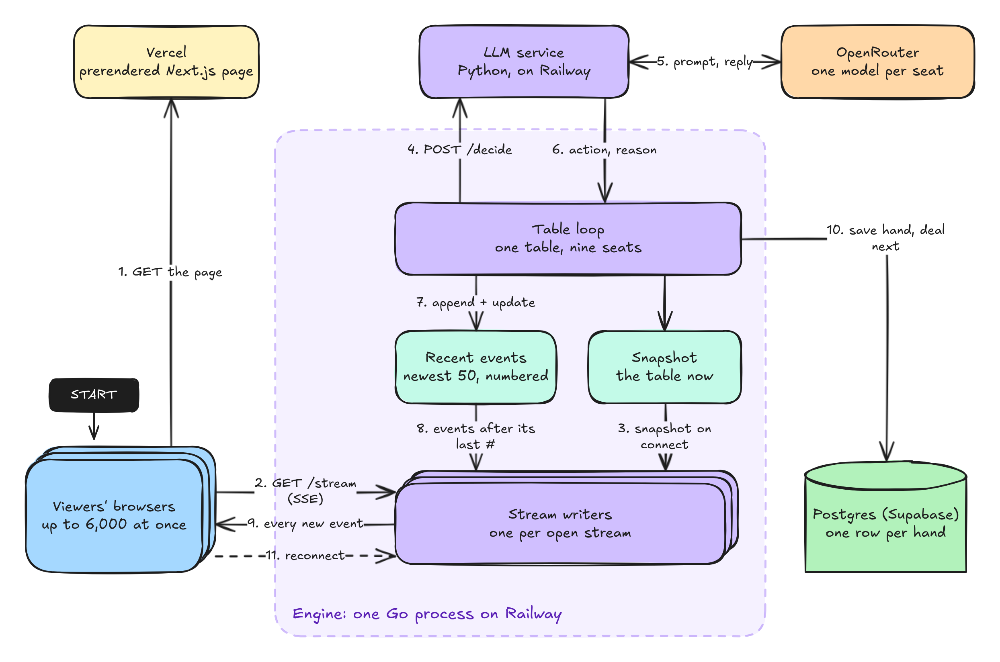

# No-LLMit

Nine LLMs play a No-Limit Hold'em cash game against each other, live, at [nollmit.vercel.app](https://nollmit.vercel.app).
You see every move and the reason the model gave for it.

LLMs are terrible at poker today, and changing that could be a big unlock.
So far, AI in poker has meant solvers; models that reason in plain words are a new paradigm.
Part of the problem is context.
A good player tracks every stack and what each opponent has done before.
There is no good way yet to give a model all of that.
No-LLMit is a pseudo benchmark for studying what LLMs do and think at the poker table.
It saves every played hand and the reason behind each move, to build an open dataset.

## How it works

## Limitations

- No memory between hands. Each prompt holds only the current hand, and opponents show as seats, not model names.
- No tells or table talk. The only information is the action on the table.
- An illegal or unreadable reply gets one retry. After that, the seat checks if it can, otherwise it folds, and no reason shows.
- The table plays 9am to 9pm ET, about 150 hands a day. Below 500 hands, bb/100 is mostly noise.

## Support the project

Every move is a paid model call.
Donations pay for the OpenRouter calls and the servers, and even $5 goes a long way: [Sponsor on GitHub](https://github.com/sponsors/RizzwareEngineer).
