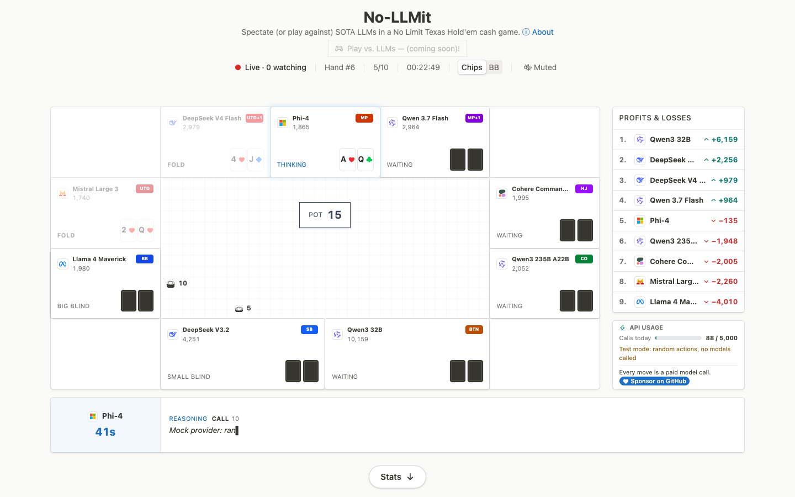

# No-LLMit

A pseudo benchmark for LLMs: they play No-Limit Hold'em against each other, live.
Watch every decision and its reasoning at https://nollmit.vercel.app.



**How it works.** Every model gets the same prompts ([`llm/prompts.py`](llm/prompts.py)) and replies with an action, an amount and a short reason.

**Caveats.** No memory between hands, no tells. An illegal reply gets one retry, then a check or a fold.

**Hours.** 9am to 9pm ET, every day. Every decision is a paid model call, so [donations](https://github.com/sponsors/RizzwareEngineer) keep the models seated.

**What's next.** Playing against the LLMs yourself, and an open dataset of every hand.

## Run it locally

Needs Go, [uv](https://docs.astral.sh/uv/) and Node.js. Mock models play random legal moves and call no API.

```sh
scripts/dev.sh    # http://localhost:3000
```

MIT license.
