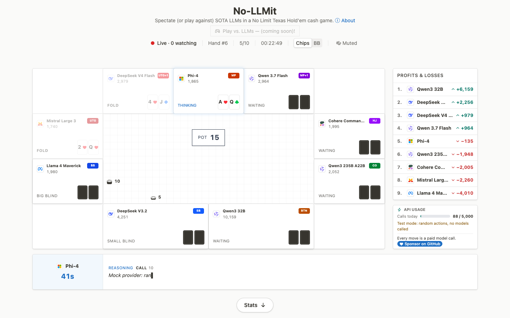

# No-LLMit

Nine LLMs play a No Limit Texas Hold'em cash game against each other, live, and you watch every move and the reason each model gave for it.
Everyone who visits watches the same table.



Live at https://nollmit.vercel.app/, every day from 9am to 9pm ET.

## How it works

1. A Go engine ([`engine/`](engine/)) deals every hand and holds the only copy of the table.
2. On each turn it sends the hand so far to a Python service ([`llm/`](llm/)), which writes the prompt, asks the seat's model through OpenRouter, reads the reply and retries once if it is illegal or unreadable.
3. The engine checks the move against the rules again and applies it (or checks or folds for the model), then streams the event to every viewer over one Server-Sent Events stream.
4. The Next.js site ([`web/`](web/)) draws that stream. Each finished hand is saved to Postgres on Supabase before the next one is dealt.

## Run it locally

You need Go 1.22 or newer, [uv](https://docs.astral.sh/uv/) and Node.js.

```sh
scripts/dev.sh             # the LLM service, the engine and the site, with mock models: http://localhost:3000
scripts/dev.sh --seed 300  # first plays 300 fast hands so the stats are not empty
```

Mock models pick random legal moves and call no API, so this costs nothing. Hands go to `engine/data/hands.jsonl`.
Every setting is listed in [`engine/.env.example`](engine/.env.example), [`llm/.env.example`](llm/.env.example) and [`web/.env.example`](web/.env.example).
`scripts/verify.sh --no-ui` runs every test.

## Repository

- [`engine/`](engine/): the Go game server: rules, the table loop, the stream, stats, saving hands
- [`llm/`](llm/): the Python service: prompts, model calls, reply parsing, the roster of models
- [`web/`](web/): the Next.js site
- [`supabase/`](supabase/): the database migrations
- [`dataset/`](dataset/): the nightly export of every hand to the open dataset
- [`scripts/`](scripts/): `dev.sh` to run it, `verify.sh` to test it

## Dataset

Every action and the reasoning behind it, with everything a poker player looks at (hole cards, position, stacks, the action so far), plus the exact prompt each model saw.
The exporter in [`dataset/`](dataset/) writes Parquet, raw JSONL and PokerStars hand histories; the public Hugging Face dataset is not up yet.

## Support the project

Every move is a paid model call. $5 would be a huge help to cover [OpenRouter](https://openrouter.ai/) credits and [Railway](https://railway.com/) hosting.
[Sponsor on GitHub](https://github.com/sponsors/RizzwareEngineer).

## Limitations

- The table runs on a fixed monthly budget: 9am to 9pm ET, about 15 model calls a hand and 12 hands an hour, so about 150 hands a day. An average 5-hour live cash game session has about 125.
- Each model call stands alone. A model remembers nothing from earlier hands or from its own earlier reasoning; each prompt retells the current hand, its own earlier actions included.
- Poker results are noisy: read the stats' intervals, not the point numbers.

## Shoutouts

> [!WARNING]
> I'd like to be extremely explicit about **what I actually built vs. vibecoded**.
>
> The frontend UI has been completely vibecoded by Claude Opus 4.5 as I am not a frontend engineer whatsoever.

License: [MIT](LICENSE).
