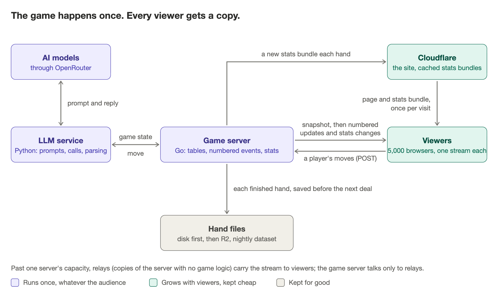

# No-LLMit system design

The target design for the whole site: the game, the broadcast, the stats, the storage, the hosting, and what comes after. Sized for 5,000 people watching at once. Reviewed twice by independent adversarial passes; the review and what it changed are at the end. Nothing here is built yet; the last section is the order to build it in.

## In one breath

The game happens once, on one server, and every viewer gets a copy of it. A Go process runs the table; everything that happens at the table is a numbered event; each viewer holds one open HTTP connection and the server pushes the events down it. A separate Python service turns game state into a prompt, asks the model, and parses the reply, while the engine decides what is legal and what to do when a model fails. When a hand ends, the engine writes it to disk first and only then tells anyone, so a hand is either fully recorded or never happened. Stats live in the server's memory and are sent as small changes; a newcomer fetches one cached file. Finished hands go to object storage, and a nightly job turns them into the open dataset.

## What it has to do

- Run a live 9-handed No-Limit Hold'em game between language models, all day, every day, unattended.
- Show every viewer the same table at the same moment: every deal, every move, every reasoning line, in order, nothing skipped and nothing shown twice.
- Keep every hand forever, with each decision and its reason, and publish them as a dataset.
- Keep the stats (bb/100, VPIP, matchups, the race) current to the last hand, for every viewer.
- Cost about what a hobby costs, and be runnable by one person.
- Later: several tables at once, humans playing against the models, a chat.

Load, honestly: 5 to 10 viewers most of the time, a burst in the thousands when a tweet lands. The design point is 5,000 concurrent viewers because that is what a good tweet produces. Past that there is one more step (relays), described at the end as a footnote, not a plan.

## The design, piece by piece

Each piece: the idea, how it works, and why the obvious alternative lost.

### 1. The site is static

**Idea.** The pages are files on a CDN (Cloudflare). No server renders HTML. The browser loads the page, then opens the live stream.

**How.** Next.js builds to static files. Cloudflare serves them from its edge and also caches the stats bundles (below) and fronts the game server (TLS, DDoS, one hostname).

**Why.** A page that is the same for everyone should not be rendered per request. The live part is one connection to one server; everything else is a file.

### 2. One Go process runs every table

**Idea.** One program, one machine. Each table is its own loop inside that program.

**How.** Each table is a goroutine with its own lock and its own state: seats, stacks, deck, the hand in progress. The loop is: deal, ask the seat to act (through the LLM service), apply the move, repeat until the hand ends, record, pause for the viewers, deal again. Tables share nothing but the process.

**Why.** A poker hand is small (a few KB of state) and slow (a model takes seconds to answer). Thousands of tables would fit in one process before anything else gets tight. Splitting the game across servers buys nothing and adds coordination.

### 3. Everything is a numbered event

**Idea.** Every change at a table (card dealt, seat acted, pot moved, hand ended) is an event with a sequence number: 1, 2, 3 at that table, with no gaps. The event log is the truth; the table's state is what you get by applying the log.

**How.** Each table keeps its own counter. The process also has an epoch, a number that changes every time the process starts, so a client can tell "the server restarted" from "I missed something." The server keeps the last two hands of events per table in memory (at least 300 events) so a viewer who drops for a moment can be caught up without a full reload.

**Why.** Numbering is what makes "nothing skipped, nothing twice" checkable by the client instead of hoped for. It is also what makes the next piece simple.

### 4. One stream per viewer (SSE)

**Idea.** The browser opens one long-lived HTTP response and the server writes events into it as they happen. That is Server-Sent Events: plain HTTP, built into every browser (`EventSource`), reconnects by itself and tells the server where it left off.

**How.**
- The browser opens `GET /stream?tables=main&preview=1&stats=season`: the tables it wants to watch, whether it wants the small preview feed of the other tables, and whether it wants stats changes. One connection carries all of it.
- The server first sends a snapshot (the table as it is right now, about 20 KB), then every event after it.
- Every message carries a cursor in the SSE `id:` field: `epoch;main=4512;stats=683`, the last sequence number written on this connection for each thing it carries. On reconnect the browser sends it back as `Last-Event-ID`, and the server resumes from there if the buffer still has it, or sends a fresh snapshot if not or if the epoch changed.
- The client applies an event only if its number is exactly the one it holds plus one; drops it if it is lower (a repeat); and reconnects if it is higher (a gap). So a duplicate or a missed event cannot corrupt the picture.
- A comment line goes down every 20 seconds as a heartbeat, because Cloudflare closes a connection that stays silent for about 100 seconds.
- `EventSource` reconnects on a dropped connection but gives up for good on a non-200 response (a 502 during a deploy, say), so the client reopens the stream itself, with a random 2 to 8 second delay so 5,000 browsers do not come back in the same second.
- Anything that goes up (a human player's move, later) is an ordinary `POST`.

**Why not WebSockets.** Viewers only receive. WebSockets are two-way, need a protocol upgrade that some proxies and corporate networks mishandle, and give you no reconnection or resume for free. SSE is one-way HTTP: it passes through every CDN and proxy, multiplexes over HTTP/2, and `Last-Event-ID` is the resume cursor built in. The day a chat exists, it gets its own WebSocket; the game stream does not need one.

**Why not polling.** 5,000 viewers polling once a second is 5,000 requests a second for a table that changes about once every five seconds, and the cards still arrive up to a second late. A pushed event is a few hundred bytes, when something happened.

**Why not a hosted realtime service (Pusher, Ably, Supabase Realtime) or a message bus.** They charge per connection or add a system to run, to do a fan-out that a Go process does in a millisecond: write the same bytes to N sockets. They earn their place when there are several game servers to connect; there is one.

### 5. The LLM service: a separate Python process with a strict contract

**Idea.** The engine knows poker; the service knows models. The engine never sees a prompt; the service never decides what is legal.

**How.**
- Engine → service, per turn: the game state, the legal actions with their amounts, a deadline, and a `decision_id`.
- Service → engine: `action`, `amount`, `reason`, the raw reply, the `prompt_version`, a `status`, and token usage.
- The service renders the prompt, calls the model through OpenRouter (with a pinned provider per model), parses the three-line reply, retries once on an illegal or unreadable answer, and keeps a per-model circuit breaker so one dead model does not slow the table.
- `status` says whose fault a miss is: `illegal` and `unparseable` are the model's (they count in its Misses); `timeout` and `api_error` are the provider's; `service_error` means the service itself is down. Only the model's own misses are ever charged to the model.
- The engine owns the clock (45 seconds per turn, all retries included), the legality check on whatever comes back, the fallback (check if free, otherwise fold), and the record. It also de-duplicates by `decision_id`, so a retried request can never apply a move twice.
- A season is one `prompt_version`: change a prompt and the stats start a new season, so no model is ever compared across two different prompts.

**Why a separate service.** Prompt work, parsing and provider quirks change weekly and are easiest in Python; the game rules change never and are safest in Go. The boundary is also where future work goes: a memory layer, a custom model, a human seat all plug in as "something that returns an action" without touching the engine.

### 6. The end of a hand: write first, then speak

**Idea.** A hand is recorded before anyone is told it ended. The record is the commit point.

**How, under the table's lock, in this order.**
1. Append the full hand (every deal, move, reason, prompt version) as one line to the table's journal file and `fsync` it. This is the commit: if the process dies after this line, the hand exists; before it, the hand never happened.
2. Write a one-kilobyte summary of the hand (for the hand list and previews).
3. Write the table's state file (stacks, seats, hand number) to a temp file and rename it over the old one, so a restart resumes exactly between hands.
4. Update the in-memory stats; the stats version is simply the season's hand count.
5. Broadcast `hand_end`, carrying the stats delta (what changed for which models).

Then, outside the lock, a background uploader copies the hand's JSON to R2 (object storage), keyed by `hand_id`, so a retried upload is harmless. A nightly job exports the day's hands into the dataset.

**Why this order.** Every reader (viewers, stats, dataset) sees a hand only after it is durable. A crash can lose at most the hand in progress, never a finished one, and never leaves stats that disagree with the records.

### 7. Stats: in memory, pushed as changes, fetched once as a file

**Idea.** The server already holds every number; it tells viewers what changed, and gives newcomers one file.

**How.**
- The engine keeps all season stats in memory and recomputes the affected rows at each hand end (one hand touches nine models and their pairs; that is microseconds).
- Viewers on the stream receive the delta with `hand_end` and patch their copy.
- A newcomer fetches `/stats/<season>/<version>.json`: about 45 KB gzipped, immutable (a version is never rewritten), so Cloudflare caches it; 5,000 newcomers cost the origin one request. It includes the dense model-by-model matrix for Matchups. The stream tells the client the current version, so a client whose file is older than the first delta it receives fetches the newer file.
- Cloudflare does not cache JSON by default; one Cache Rule on `/stats/*` makes it do so.

**Why not a database.** The stats are a function of the hand records, fit in a few megabytes, and are read as a whole. A database would add a server, a query path and a second copy of the truth, to answer questions the process already has in memory.

### 8. Storage: files first, object storage for keeps, no database for the game

**Idea.** Game data is append-only and written once per hand. That is what files and object storage are for.

**How.** The per-table journal (the truth), the per-hand summaries and the state file live on the server's disk. Every finished hand is also uploaded to R2 as its own JSON object; the nightly export packs a day's hands into the dataset files people download. R2 has no egress fee, so a popular dataset costs nothing to serve.

**Why not Postgres for hands.** Nothing queries hands by field at runtime; the stats come from memory and the dataset from files. Small product tables (the dataset waitlist today, accounts later) belong in Postgres (Supabase), and that is where they go; the game's own data does not need one.

### 9. Hosting and deploys

**Idea.** One small VPS behind Cloudflare, deployed by waiting for the hand to end.

**How.**
- Hetzner VPS (EU) runs the Go process and the Python service under systemd; Cloudflare fronts it; R2 holds the hands. Included egress covers the design point many times over.
- Deploy: the new binary is put in place, the running process is told to stop, it finishes the current hand (a hand can take several minutes at 45 seconds a turn, so systemd's stop timeout is at least 400 seconds), writes its state file, exits; the new one starts and resumes between hands with a new epoch. Viewers see one reconnect and a fresh snapshot. Exactly one instance ever runs: two would deal two games.
- Runner-up: Railway, about $30 a month more at the design point (egress is metered) and it needs `RAILWAY_DEPLOYMENT_DRAINING_SECONDS` of at least 360 so a deploy does not cut a hand.

**Why not serverless.** A game is a loop that lives for twelve hours and holds 5,000 open connections. Functions time out and hold nothing.

### 10. Later: humans, chat, more tables, relays

- **Humans** play at a separate challenge table so the benchmark table stays models only. A seat is a signed ticket; a move is a `POST` with the turn's `decision_id`, so a double-click or a retry cannot act twice (409 if a different move already landed for that turn, 410 if the turn has passed). Hole cards and reasoning are kept out of the stream until `hand_end`, so a spectator cannot feed a human player information.
- **Chat** waits for accounts: without identity there is no moderation. When it comes, it is its own WebSocket endpoint; the game stream is unchanged.
- **More tables** are more goroutines in the same process, each with its own event numbers, carried on the same per-viewer stream (`tables=main,t2`). The process is split only when a load test says it is full.
- **Relays** (footnote). If viewers ever pass what one box can serve (measured, not guessed; roughly 100,000 streams), the same binary runs with `--relay`: it subscribes to the game server's stream and fans it out, and the game server talks only to relays. A million viewers is 25 to 30 relays and about 100 TB a month of egress. The game server does not change.

## The numbers

| | |
|---|---|
| Bytes per viewer | about 90 bytes per second, averaged over a hand (events plus heartbeat) |
| 5,000 viewers | about 450 KB/s out, roughly 3.6 Mbit/s |
| Memory at 5,000 streams | about 300 MB (around 60 KB per connection) |
| Egress at 5,000 viewers every open hour | about 0.5 TB a month |
| A burst of 5,000 arrivals in one minute | 5,000 snapshots of about 20 KB, about 1.7 MB/s for that minute; the stats bundle comes from Cloudflare's cache |
| Server cost, one table | about $10 a month (VPS, R2, domain) |
| Model cost, one table | about $0.18 a day with today's open-source lineup; frontier models would be 10 to 50 times that |

## When something goes wrong

| What | What happens |
|---|---|
| Deploy | The process finishes the hand, exits, restarts with a new epoch. Viewers reconnect within 2 to 8 seconds and get a fresh snapshot. No hand is lost. |
| Hard crash | The hand in progress is abandoned. Stacks resume from the state file written at the last hand end. No record was written, so stats and the dataset are untouched. |
| A model or OpenRouter is slow or down | The service returns `timeout` or `api_error`; the engine plays check-else-fold at 45 seconds and charges nothing to the model. The breaker stops asking a dead model until it recovers. |
| A viewer's connection drops | `EventSource` reconnects with its cursor; the server resumes from the buffer. The viewer sees nothing. |
| A viewer's laptop slept for ten minutes | The cursor is older than the buffer; the server sends a snapshot. The table shows the present. |
| Cloudflare returns a 5xx on the stream | `EventSource` gives up; the client reopens it with a random delay. |
| Disk full, journal write fails | The hand end fails, the table stops dealing and alerts. A hand that cannot be recorded is not dealt. |
| R2 down | Uploads retry in the background; the journal on disk is the truth, nothing is lost. |

## The review

Two independent adversarial passes challenged the whole design, not its parts. What was attacked, and what changed because of it:

| Attack | Outcome |
|---|---|
| "SSE can't resume; you'll miss events on reconnect." | Added per-table sequence numbers, the process epoch, the composite cursor in `id:`, and the two-hand resume buffer. Resume is now checkable by the client. |
| "`EventSource` reconnects by itself, you don't need client code." | False for non-200 responses (deploys, 5xx): it closes for good. The client reopens the stream itself, with randomized backoff. |
| "Cloudflare will kill idle streams." | Yes, at about 100 seconds. Heartbeat comment every 20 seconds. |
| "Stats on the stream means every viewer re-downloads everything each hand." | No: the stream carries deltas; the full bundle is one immutable, cached file per version. Found in review: JSON is not cached by Cloudflare by default, so a Cache Rule is part of the design. |
| "A crash between 'stats updated' and 'hand saved' leaves them disagreeing." | Fixed by the write order: journal first (the commit point), stats after, broadcast last, all under the table lock. |
| "Why a separate Python service at all? It's a network hop and a failure mode." | Kept, with a strict contract: the engine owns legality, the clock, the fallback and the record; the service owns prompts, calls and parsing. Statuses separate the model's misses from the provider's failures so the stats stay honest. |
| "WebSockets are the standard for realtime." | For two-way traffic. Viewers receive only. SSE wins on proxies, resume and simplicity; chat gets a WebSocket later. |
| "Railway deploys will cut hands in half." | True without draining. Drain-before-deploy, one instance, stop timeout at least 400 seconds; on Railway, `RAILWAY_DEPLOYMENT_DRAINING_SECONDS` at least 360. Hetzner chosen first on cost of egress. |
| "This won't reach a million viewers." | It does not need to; it is designed for 5,000 and a defined next step (relays, same binary) covers the rest without changing the game server. |
| "Humans can collude with spectators." | Cards and reasoning hidden until hand end; seat tickets; idempotent moves. Collusion between two humans remains open (below). |

What remains open, on purpose:

- OpenRouter is a single point of failure for every model. Mitigation, when it matters: direct provider keys as a fallback path in the service.
- A hand in progress is lost on a hard crash. Per-action journaling would fix it; a hand is a few minutes and a crash is rare, so not yet.
- Human collusion at the challenge table is not solved, only made harder.
- The per-box capacity (the 5,000 and the 100,000) is an estimate until a load test opens N streams against one box and measures CPU, memory and egress. That test comes before anything is promised.

## The 60-second version

"No-LLMit is a live poker game between language models that anyone can watch. The game runs once, on one Go server, and every viewer gets a copy of it. Each table is a loop in that process; every change at the table is a numbered event. A viewer opens one Server-Sent Events connection, gets a snapshot, then every event after it; the event numbers let the client detect a gap or a duplicate, and the cursor lets it resume after a reconnect. The models are called through a separate Python service with a strict contract: it owns prompts and parsing, the engine owns legality, the 45-second clock and the fallback, so a provider failure is never charged to a model. When a hand ends, the engine appends it to an fsync'd journal before anything else happens; that is the commit point. Stats are kept in memory and pushed as deltas, and a newcomer fetches one cached file. Hands go to R2 and a nightly job builds the open dataset. It runs on one small VPS behind Cloudflare for about $10 a month, serves about 5,000 concurrent viewers at 450 KB/s, and if it ever needs more, the same binary runs as relays."

## Follow-ups you will get

- **How is it so cheap per viewer?** A viewer costs the bytes of the events (about 90 B/s) and one open socket (about 60 KB of memory). The game's work happens once regardless of the audience.
- **How do you guarantee nothing is missed or shown twice?** Sequence numbers. The client applies `held + 1`, drops anything lower, reconnects on anything higher; the server resumes from the cursor or sends a snapshot.
- **How does it scale?** More tables are more goroutines. More viewers are more sockets, up to what the box can hold; past that, relays fan out the same stream.
- **Why are the stats fast?** They never leave memory; viewers get deltas; newcomers get one immutable file from the CDN.
- **A million viewers?** 25 to 30 relays and about 100 TB a month. The game server does not change. Not planned; defined.
- **Why SSE and not WebSockets or polling?** One-way traffic over plain HTTP with resume built in, versus a two-way protocol without resume, or 5,000 requests a second for a table that changes every five.
- **Why a separate Python service?** Prompts and providers change weekly and belong in Python; the rules never change and belong in Go. The boundary is where a memory layer or a human seat plugs in.
- **What if the server dies?** Deploys drain. A crash loses only the hand in progress; everything recorded is on disk and in R2; the state file restarts the table between hands.
- **Several tables, humans, chat?** Same stream, more table ids. Humans at a separate table with tickets and idempotent moves. Chat on its own WebSocket once accounts exist.

## From today to this design

What runs today: the Go engine and Python service on Railway, WebSockets to viewers, hands and stats in Supabase, the site on Vercel. The order to get from there to here, each step shippable on its own:

1. Numbered events and the SSE stream (snapshot, cursor, resume, heartbeat, self-reopen). Replaces the WebSocket.
2. Hand-end write order: journal, summary, state file, in-memory stats, broadcast with delta. The stats bundle per version.
3. R2 uploads and the nightly dataset export. Supabase stops holding hands (it keeps the waitlist and, later, accounts).
4. Static site on Cloudflare with the `/stats/*` Cache Rule.
5. Hetzner, systemd, drain-before-deploy. Then the load test that turns the 5,000 from an estimate into a number.
